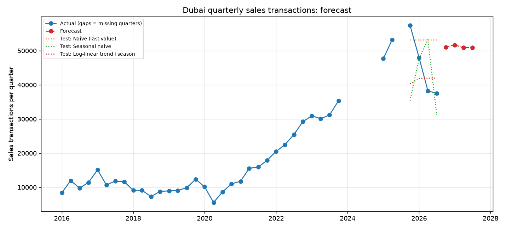

# Dubai Real Estate Intelligence Platform

A data science and AI project on the Dubai property market. The end goal is a platform that estimates
the fair value of a property, explains the drivers behind it, and answers investor questions through an AI assistant.

**Current status: Phase 1 complete (market data cleaning and quarterly sales forecast).**

## Roadmap

- [x] **Phase 1:** Clean the Dubai Land Department quarterly market summary and forecast sales volume
- [ ] **Phase 2:** Property-level valuation model (XGBoost / LightGBM) with SHAP explanations
- [ ] **Phase 3:** RAG assistant that answers questions over market data and regulations
- [ ] **Phase 4:** Deployed Streamlit app and dashboard

## Data

- **Source:** Dubai Land Department real estate transactions for the Emirate of Dubai (downloaded 2026-10-24).
- **Granularity:** quarterly totals by transaction type (sales, mortgages, other) and property type
  (units, villas, buildings, land), as number of transactions and value in AED. It is aggregate data, not property-level.
- **Coverage:** 2016 Q1 to 2026 Q3.
- **Known gaps:** all of 2024 and 2025 Q3 are missing in the source file. Missing quarters are kept as
  gaps and are never interpolated.
- The raw file is not included in this repo. Download it from the official source and place it in `data/raw/`.
  Check the dataset's terms before reusing it.

## Phase 1 results

### Market overview (sales transactions, all property types)

| Year | Transactions | Value (AED bn) | Quarters in data |
|---|---|---|---|
| 2020 | 35,315 | 72.3 | 4 |
| 2021 | 61,169 | 151.0 | 4 |
| 2022 | 97,705 | 266.7 | 4 |
| 2023 | 127,612 | 399.9 | 4 |
| 2025 | 158,353 | 512.3 | 3 (Q3 missing) |
| 2026 | 123,741 | 378.7 | 3 (to Q3) |

Sales activity grew strongly from 2021 through 2025. In 2026 it slowed: quarterly transactions fell from
about 48,000 in Q1 to about 37,500 in Q3, and quarterly sales value fell from AED 176bn to AED 93bn.

### Forecasting quarterly sales transactions

The models are evaluated on the last four observed quarters (2025 Q4 to 2026 Q3), using a time-based split.

| Model | MAE (transactions) | MAPE |
|---|---|---|
| Naive (repeat last value) | 10,037 | 24.8% |
| Seasonal naive | 10,895 | 23.7% |
| Log-linear trend + season (Ridge) | 7,867 | 16.1% |



The trend-plus-season model beats both baselines. It forecasts roughly 51,000 sales per quarter for
2026 Q4 to 2027 Q3.

### Limitations

- **The model misses the 2026 slowdown.** It learns a strong upward trend from earlier years, so its forecast
  is likely too high given the recent decline. Treat it as a baseline, not a prediction to rely on.
- **Small sample.** Roughly 40 quarters, and the test window is only four quarters.
- **Missing quarters.** 2024 and 2025 Q3 are absent, which weakens trend and seasonality estimates.
- **Aggregate data.** This data cannot value an individual property. That requires property-level data (Phase 2).

### Next improvements

1. Fill the missing quarters from another official source.
2. Add leading indicators such as mortgage volume.
3. Compare against ETS / SARIMA and evaluate with rolling-origin cross-validation.

## Project structure

```
data/raw/            raw downloads (not tracked)
data/processed/      cleaned data (not tracked)
src/clean_market.py  cleans the quarterly market file
src/forecast.py      baselines and forecasting model
reports/             charts and metrics
notebooks/           exploration
```

## How to run

```bash
python3 -m venv .venv
source .venv/bin/activate
pip install -r requirements.txt

# put the Dubai Land Department CSV in data/raw/
python3 src/clean_market.py
python3 src/forecast.py
```

Outputs: `data/processed/market_quarterly.csv`, `reports/forecast.png`, `reports/forecast_metrics.csv`.
