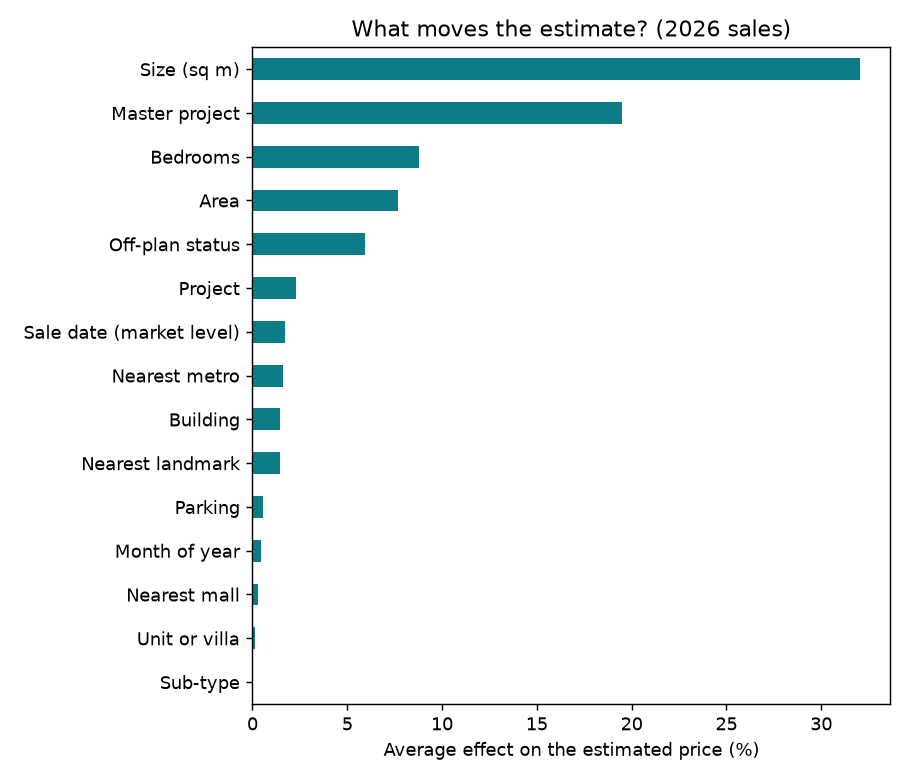
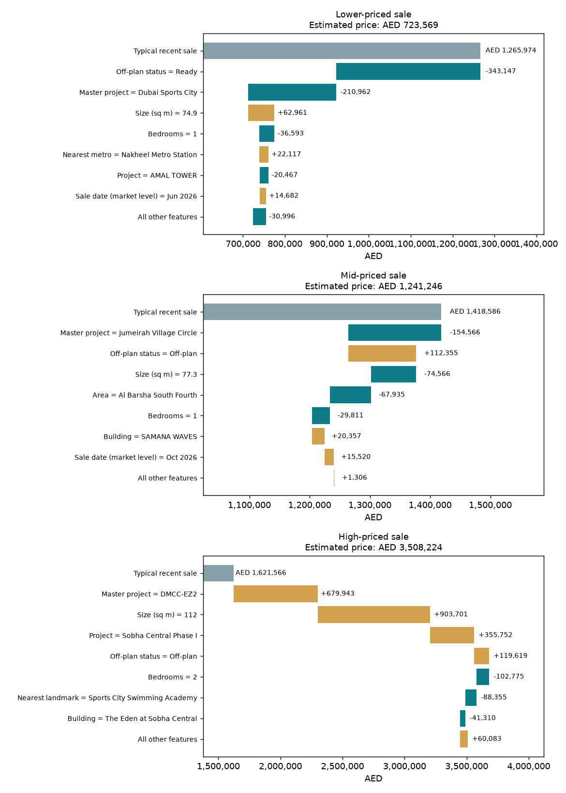

# Dubai Real Estate Intelligence Platform

A data science and AI project on the Dubai property market. It forecasts market activity, estimates the price of
an individual apartment or villa, explains why the model gives a particular price, and answers questions about
Dubai property regulations from official documents.

**Live app: https://dubai-real-estate-ai-kdge5fuetmryzocfsbqfyx.streamlit.app/**

**Status: all four phases complete.**

## Roadmap

- [x] **Phase 1:** Clean the quarterly market summary and forecast sales volume
- [x] **Phase 2:** Property-level price model, evaluated on unseen 2026 sales
- [x] **Phase 3:** Explanations of the model's estimates, and a regulations assistant with a retrieval test
- [x] **Phase 4:** Public web app (price estimator and market explorer) on Streamlit Community Cloud

## Data

| Dataset | Used for | Notes |
|---|---|---|
| DLD real estate transactions, quarterly summary | Phase 1 forecast | Aggregate counts and values, 2016 Q1 to 2026 Q3. All of 2024 and 2025 Q3 are missing in the source. |
| DLD real estate transactions, property-level | Phases 2 and 3a | About 904k raw records (one part of a multi-part download). |
| Official legal texts and a DLD press release | Phase 3b assistant | See "Documents used" below. |

Raw data and documents are not included in this repo. Download them from the official Dubai Land Department,
Dubai Pulse and Dubai Legislation Portal sites, and check each source's terms before reuse.

### Cleaning (property-level data)

From 903,704 raw records, `src/clean_sales.py` keeps **336,945** residential sales (flats, villas, stacked
townhouses) from 2020-01 to 2026-10. It removes mortgages and gifts, developer bulk deals, impossible dates (some
records are dated the year 1420 or in the future), and implausible prices and sizes. Every rule is a constant at
the top of the script, and the rows dropped at each step are saved in `reports/cleaning_log.txt`. 67.9% of the
remaining sales are off-plan.

`meter_sale_price` is deliberately not used as a feature: it is the price divided by the area, so using it would
leak the answer into the model.

## Phase 2: price model

The model predicts the log of the sale price from size, rooms, off-plan or existing status, parking, location
(area, project, building), nearest metro, mall and landmark, and the sale month.

**Evaluation is split by time, not at random.** Training uses sales up to September 2025, validation is Q4 2025,
and the test set is all 54,521 sales from 2026, which the model never saw.

| Metric (2026 test set) | Baseline | Gradient boosting model |
|---|---|---|
| Mean absolute error | AED 384,186 | **AED 299,170** |
| Median absolute error | AED 161,969 | **AED 128,152** |
| Median % error | 13.1% | **9.8%** |
| Estimates within 10% of actual price | 39.8% | **50.7%** |
| Estimates within 20% of actual price | 68.2% | **77.4%** |
| R² | 0.824 | **0.884** |

The baseline is the median price per sq m over the last 12 months in the same area and off-plan status,
multiplied by the property size.

| Segment | Median % error | R² | Test sales |
|---|---|---|---|
| Units | 9.9% | 0.883 | 49,749 |
| Villas | 8.8% | 0.809 | 4,772 |
| Off-plan | 9.7% | 0.883 | 41,426 |
| Existing | 10.2% | 0.889 | 13,095 |

Charts: `reports/pred_vs_actual.png` and `reports/feature_importance.png`.

### Limitations

- About one in four estimates is off by more than 20%. The data has no floor, view, finish or condition.
- Prices are registered transaction values, not listing prices.
- The model was trained on 2020 to 2025 and tested on 2026. Tree-based models cannot extrapolate beyond the
  dates they have seen, so the model effectively assumes late-2025 price levels. Regular retraining is needed.
- Villa results rest on only 4,772 test sales.
- The model learns apartment versus villa mostly through project, building and nearby-landmark context, not from
  the property type itself (type and sub-type had about 0% effect in the explanations). The web app therefore asks
  for a project, and only offers areas that have recent sales of the chosen type.
- Training hit the 800-iteration cap, so tuning could improve results slightly.
- The model is scikit-learn's `HistGradientBoostingRegressor`. The script uses LightGBM automatically when it can
  be loaded, which was not possible on the Intel Mac this was developed on.

## Phase 3a: why does the model give this price?

`src/explain.py` computes Shapley-value attributions by permutation sampling: for each property, the average
effect of each feature on the estimate when switching from a typical recent sale to this property's values. It
uses the same idea as SHAP's permutation explainer and works with any model. It was run on 300 random 2026 sales
against 150 typical 2025 sales.

| Feature | Average effect on estimate |
|---|---|
| Size (sq m) | 32.0% |
| Master project | 19.5% |
| Bedrooms | 8.8% |
| Area | 7.7% |
| Off-plan status | 5.9% |
| Project | 2.3% |
| Sale date (market level) | 1.7% |
| Nearest metro | 1.6% |
| Building | 1.5% |
| Nearest landmark | 1.5% |
| Parking, month, mall, unit or villa, sub-type | 1.4% combined |

Grouped by theme: size and layout about 41%, location about 34% (split across overlapping features, so read it
as one group), off-plan or ready about 6%, timing about 2%.




Findings:

- Size and location dominate, as expected. Seasonality (month of year) is negligible, which is reassuring.
- The sale date has only a small effect. This reflects the extrapolation limit above: 2026 sales are later than
  anything the model trained on.

## Phase 3b: regulations assistant

`src/rag.py` answers questions about Dubai property rules from official documents. It splits each document at
article and schedule headings (so every passage carries its document and article number), ranks passages with
hybrid keyword search (word matching plus character matching, with a short list of everyday-to-legal word
hints), and returns the best passages with sources. If nothing is relevant enough it says so, rather than guess.
With `--llm` and an Anthropic API key, Claude writes a short answer from the retrieved passages only, citing
them. That mode has not been tested in this project.

```bash
python3 src/rag.py "Who pays the registration fee when a property is sold?"
```

### Documents used

- Law No. (8) of 2007 Concerning Escrow Accounts for Real Estate Development in the Emirate of Dubai
- Executive Council Resolution No. (30) of 2013 Approving Fees of the Land Department
- Decree No. (43) of 2013 Determining Rent Increase for Real Property in the Emirate of Dubai
- Law No. (33) of 2008 Amending Law No. (26) of 2007 Regulating the Relationship between Landlords and Tenants
- Dubai Land Department press release: "Smart Rental Index 2025" (2 January 2025)

The legal texts come from the Dubai Legislation Portal. The English versions state that the Arabic text prevails.

### Retrieval test

`src/rag_eval.py` runs 24 questions: 18 with an answer in the documents and 6 off-topic. A question counts as a
hit if one of the retrieved passages comes from the right document and contains the phrase that answers it.

| Measure | Result |
|---|---|
| Right passage ranked first | 78% (14 of 18) |
| Right passage in the top 3 | 94% (17 of 18) |
| Off-topic questions correctly given no answer | 100% (6 of 6) |

The one miss: "How much notice is needed before changing the rent at renewal?" The answer (90 days, Article 14 of
Law No. 33 of 2008) is worded as "notify... amend its terms", so keyword search cannot connect it to "notice" and
"changing". Meaning-based (embedding) search is the natural upgrade.

Caveat: the word hints and the "nothing relevant" cutoff were adjusted after seeing the first round of misses on
these same questions, so the results are somewhat optimistic. A fresh set of questions would give a fairer score.

### Things the documents showed

- **Who pays the 4% registration fee.** The fee resolution sets the sale fee at 4% of the contract value and says
  that, unless the parties agree otherwise, the sale fee is shared equally by seller and purchaser. Some
  property blogs describe the buyer paying all of it. Market practice may differ from the default rule.
- **A likely typo in a press release.** The Smart Rental Index release cites "Decree No. (34) of 2013" for rent
  increases, while the decree text is Decree No. (43) of 2013.
- **Amending laws reuse article numbers.** Law No. 33 of 2008 replaces articles of the 2007 law, so its numbers
  refer to the original law, and one article number appears twice. The assistant labels the repeat explicitly.

The assistant gives general information, not legal advice. Laws can be amended, so check the current official
version.

## Phase 4: web app

Live at **https://dubai-real-estate-ai-kdge5fuetmryzocfsbqfyx.streamlit.app/** (free hosting: the app may be asleep when unused and take a moment to wake up).

- **Price estimator:** choose property type, area, project, status, size, bedrooms and parking. It shows an
  estimated price with a likely range (plus or minus 10%) and where the price per sq m sits against typical sales
  in that area over the last 12 months.
- **Market explorer:** most expensive areas, a price-versus-off-plan-share bubble chart, and quarterly price and
  volume trends for units and villas.
- **About the model:** the test results, charts and limitations.

The app reads small summary files (`app/data/`) and the saved model, never the raw data. `src/prepare_deploy.py`
builds those files, compresses the model, and pins the package versions that trained it. The regulations
assistant runs locally only, because the official documents are not redistributed in this repo.

## Phase 1: quarterly sales forecast

On the last four observed quarters, a trend-plus-season model reaches 16.1% MAPE, against 24.8% for repeating the
last value and 23.7% for the seasonal naive baseline. It does not capture the 2026 slowdown, so it is a baseline,
not a forecast to rely on. See `reports/forecast.png`.

## Run it

```bash
python3 -m venv .venv
source .venv/bin/activate
pip install -r requirements.txt
pip install pypdf     # to read PDF documents in Phase 3b

python3 src/clean_market.py                                  # Phase 1 data
python3 src/forecast.py                                      # Phase 1 forecast
python3 src/clean_sales.py data/raw/<transactions_file>.csv  # Phase 2 data
python3 src/train_price_model.py                             # train and evaluate
python3 src/explain.py                                       # Phase 3a explanations
# put the documents in data/docs/
python3 src/rag.py "your question"                           # Phase 3b assistant
python3 src/rag_eval.py                                      # Phase 3b retrieval test
python3 src/prepare_deploy.py                                # Phase 4: app data and model
streamlit run app/streamlit_app.py                           # Phase 4: run the app locally
```

## Structure

```
src/clean_market.py          quarterly market summary cleaning
src/forecast.py              Phase 1 forecasting
src/profile_transactions.py  chunked profile of the large transactions file
src/clean_sales.py           property-level cleaning
src/train_price_model.py     training, evaluation, charts
src/explain.py               Shapley-value explanations
src/predict.py               load the model and estimate one price
src/rag.py                   regulations assistant
src/rag_eval.py              retrieval test
src/prepare_deploy.py        builds the app's data files, compresses the model, pins versions
app/streamlit_app.py         web app
app/charts.py                chart helpers
app/data/                    small summary files used by the app
reports/                     metrics, charts, cleaning log, retrieval test results
```
